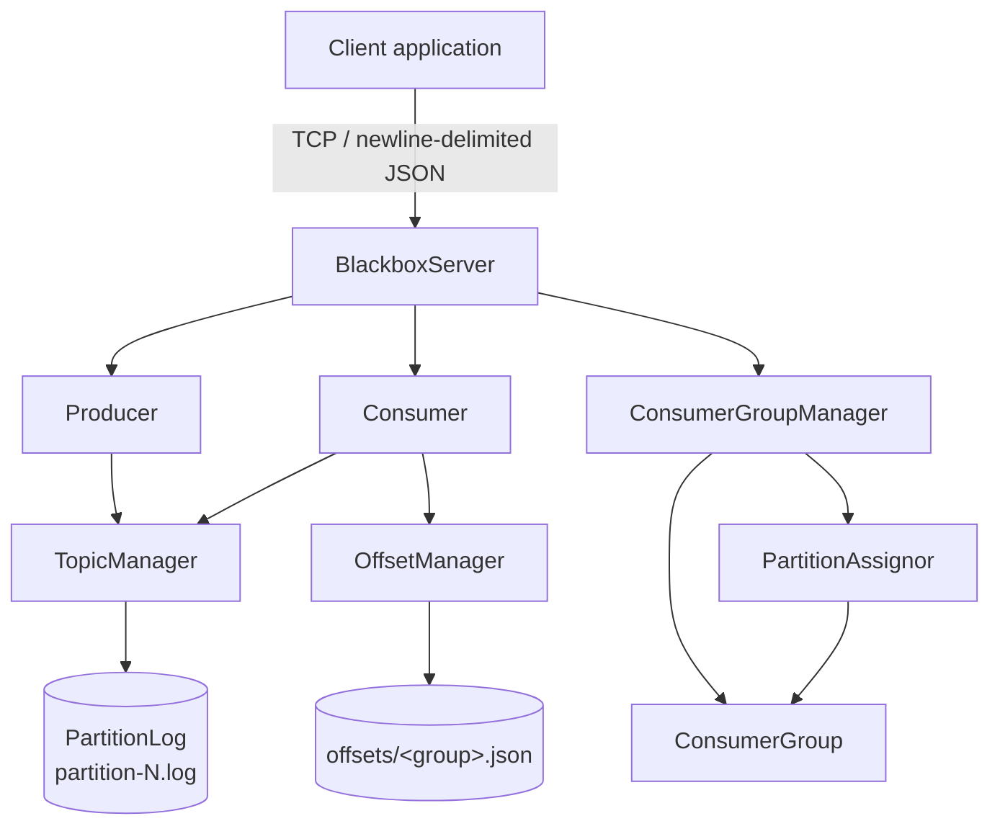
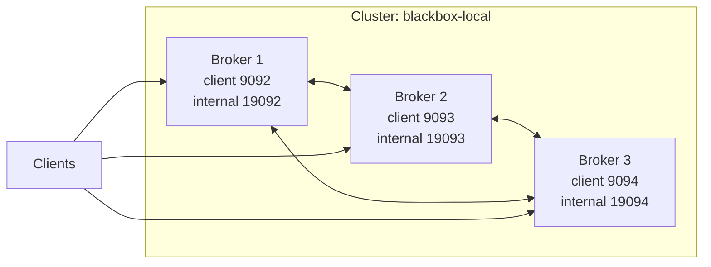
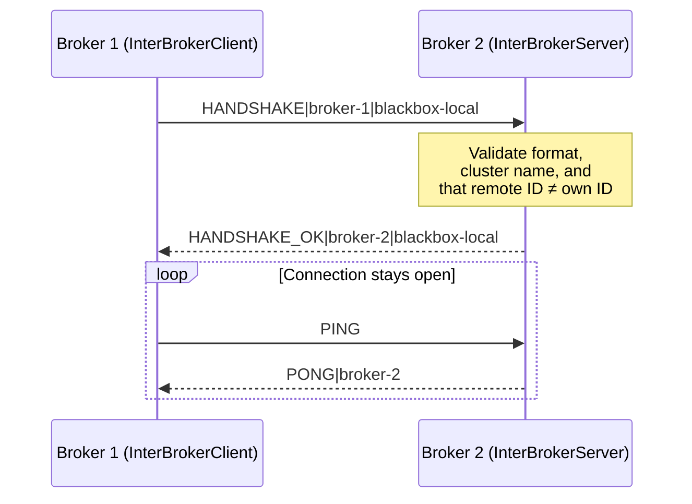

# BLACKBOX

### A Kafka-inspired messaging broker built from scratch in Java


BLACKBOX is a lightweight messaging broker written in plain Java (Java NIO, TCP sockets, Gradle). It is modeled on the core ideas of Apache Kafka: **append-only partitioned logs**, **offset-based consumption**, **consumer groups with partition assignment**, and **broker-to-broker networking**.

It deliberately avoids messaging frameworks. The goal is to understand *why* reliable messaging systems are designed the way they are by building each mechanism by hand, then growing the project step by step into a distributed event-streaming platform.

> **Project status:** a fully working single-broker system (storage, topics, producers, consumers, consumer groups, TCP API) plus a multi-broker networking foundation (handshake, persistent connections, PING/PONG). Replication, leader election and failover are **not implemented yet**. See [Current limitations](#current-limitations) and the [Roadmap](#roadmap).

---

## Table of contents

1. [What you can do with it](#what-you-can-do-with-it)
2. [Key features](#key-features)
3. [Architecture](#architecture)
4. [How it works](#how-it-works)
   - [Storage and offsets](#storage-and-offsets)
   - [Producer: partition selection](#producer-partition-selection)
   - [Consumer groups and rebalancing](#consumer-groups-and-rebalancing)
   - [Assignment-aware fetching](#assignment-aware-fetching)
   - [Offset management](#offset-management)
   - [Multi-broker communication](#multi-broker-communication)
5. [TCP API reference](#tcp-api-reference)
6. [Quick start](#quick-start)
7. [End-to-end walkthrough](#end-to-end-walkthrough)
8. [Runtime storage layout](#runtime-storage-layout)
9. [Design decisions](#design-decisions)
10. [Current limitations](#current-limitations)
11. [Implementation status and roadmap](#implementation-status-and-roadmap)
12. [Technology stack](#technology-stack)

---

## What you can do with it

- Create topics with a configurable number of partitions.
- Publish messages over TCP and get back the `partition` and `offset` assigned to each one.
- Read messages from any partition at any offset.
- Create consumer groups, subscribe them to topics, add or remove consumers, and watch partitions get rebalanced automatically.
- Consume as a group member, with the broker enforcing which partitions you are allowed to read and resuming from your last committed offset.
- Run several broker processes that discover each other, handshake, and keep persistent connections open.

---

## Key features

| Area | What is implemented |
|---|---|
| **Persistent storage** | Append-only binary partition logs via Java NIO `FileChannel`; sequential offsets per partition; offset recovery when a log is reopened |
| **Topics and partitions** | Dynamic topic creation, configurable partition count, one independent log file per partition, automatic topic discovery and recovery on startup, partition-numbering validation during recovery |
| **Producer** | Round-robin partition selection, thread-safe via `AtomicInteger`, returns assigned partition and offset |
| **Consumer** | Offset-based fetch with a configurable limit, partition-specific retrieval, group-aware polling from committed offsets, explicit offset commits |
| **Offset management** | Independent offsets per consumer group, JSON persistence, validation before commit, resume from last committed position |
| **Group coordination** | Group creation, consumer join/leave, duplicate registration prevention, round-robin assignment, per-topic assignment storage, automatic rebalancing on membership or subscription changes |
| **Assignment-aware fetch** | Verifies group membership, topic subscription and partition ownership before serving data |
| **TCP server** | Java-socket server, newline-delimited JSON protocol, one thread per client connection, structured error responses |
| **Multi-broker networking** | Shared `cluster.properties`, unique broker IDs, separate client and internal ports, handshake with cluster-name and identity validation, startup retries, persistent peer connections, PING/PONG |

---

## Architecture

BLACKBOX separates storage, messaging, networking, consumer coordination and inter-broker communication into distinct packages.

```text
BLACKBOX
│
├── Main.java                      # Startup and dependency wiring
│
├── message/
│   └── Message.java               # Immutable message model
│
├── storage/
│   └── PartitionLog.java          # Binary log + offset management
│
├── topic/
│   └── TopicManager.java          # Topic creation, partitions, recovery
│
├── producer/
│   └── Producer.java              # Publishing + partition selection
│
├── consumer/
│   ├── Consumer.java              # Fetching + group-aware consumption
│   ├── OffsetManager.java         # Persistent committed offsets
│   ├── ConsumerGroup.java         # Membership + per-topic assignments
│   ├── ConsumerGroupManager.java  # Lifecycle, subscriptions, rebalancing
│   └── PartitionAssignor.java     # Round-robin distribution
│
├── network/
│   └── BlackboxServer.java        # Client-facing TCP server + routing
│
├── cluster/
│   ├── ClusterConfig.java         # Cluster config loading/validation
│   ├── InterBrokerServer.java     # Accepts broker-to-broker connections
│   └── InterBrokerClient.java     # Connects to and maintains peer links
│
└── resources/config/
    └── cluster.properties
```

### Component responsibilities

| Component | Responsibility |
|---|---|
| `Message` | Immutable message representation |
| `PartitionLog` | Binary message storage and offset management |
| `TopicManager` | Topic creation, partition management, startup recovery |
| `Producer` | Message publishing and partition selection |
| `Consumer` | Message fetching and group-aware consumption |
| `OffsetManager` | Persistent consumer group offset tracking |
| `ConsumerGroup` | Group membership and topic-specific partition assignments |
| `ConsumerGroupManager` | Group lifecycle, membership, subscriptions, rebalancing |
| `PartitionAssignor` | Round-robin partition distribution |
| `BlackboxServer` | Client-facing TCP communication and request routing |
| `ClusterConfig` | Loads and validates broker cluster configuration |
| `InterBrokerServer` | Accepts and handles broker-to-broker connections |
| `InterBrokerClient` | Establishes and maintains connections to peer brokers |
| `Main` | Application initialization and dependency wiring |

### Single-broker request flow



Messages live in partition-specific append-only logs. Consumer group *progress* is stored separately in offset files. Consumer group *membership and assignments* are managed by dedicated components and are recalculated whenever a consumer joins or leaves, or a group subscribes to a topic.

> **Persistence distinction:** consumer group **offsets are persisted to disk**. Group **membership and partition assignments live in memory** and must be recreated through the TCP API after a broker restart.

### Multi-broker topology

Each broker is its own process with its own ports and its own data and offset directories.



Brokers talk to each other only over the **internal** port. Clients only use the **client** port.

---

## How it works

### Storage and offsets

Every topic has one or more partitions, and **every partition has its own log file and its own offset sequence**.

```text
data/
└── orders/
    ├── partition-0.log
    ├── partition-1.log
    └── partition-2.log
```

| Partition | Offset | Message |
|---|---|---|
| 0 | 0 | Order created |
| 0 | 1 | Payment received |
| 1 | 0 | Order dispatched |
| 2 | 0 | Order cancelled |

Offsets are only meaningful *within* a partition. Offset `0` exists in every partition.

Messages are appended using binary serialization. On restart, `PartitionLog` rebuilds its next offset by reading the existing records, and `TopicManager` rediscovers topics from the data directory (validating that partition numbering is consistent).

**Why append-only?** Sequential writes are fast, offsets become trivial (the position in the log), and previously written data is never mutated, which keeps recovery simple.

### Producer: partition selection

The producer picks a partition using round-robin and an `AtomicInteger` counter, so concurrent publishers never race on the selection.

```text
Message 1 → Partition 0
Message 2 → Partition 1
Message 3 → Partition 2
Message 4 → Partition 0
Message 5 → Partition 1
Message 6 → Partition 2
```

The response always tells you where the message landed (`partition` and `offset`).

> Messages carry a `key`, but partitioning is currently round-robin rather than key-hash based. See the [roadmap](#implementation-status-and-roadmap) and [design decisions](#design-decisions).

### Consumer groups and partition assignment

A consumer group is a set of consumers that share the work of reading a topic. Each group has a unique ID and its own membership, and different groups can read the same topic independently with separate offsets.

```text
payment-service
├── consumer-1
├── consumer-2
└── consumer-3
```

`PartitionAssignor` distributes partitions cyclically. For a topic with six partitions and three consumers:

```text
consumer-1 → [0, 3]
consumer-2 → [1, 4]
consumer-3 → [2, 5]
```

`ConsumerGroup` stores assignments **per topic**, and `ConsumerGroupManager` coordinates membership and triggers rebalancing.

#### Automatic rebalancing

Rebalancing runs when a consumer joins, a consumer leaves, or the group's topic subscription changes.

```text
Before                       After removing consumer-2
consumer-1 → [0, 3]          consumer-1 → [0, 2, 4]
consumer-2 → [1, 4]          consumer-3 → [1, 3, 5]
consumer-3 → [2, 5]
```

Current assignments can be queried at any time with `GET_ASSIGNMENTS`.

> There are no heartbeats yet. A consumer that crashes without sending `LEAVE_GROUP` stays in the group until it is removed explicitly.

### Assignment-aware fetching

`FETCH_GROUP` checks three things before returning data:

1. The consumer is a member of the group.
2. The group is subscribed to the requested topic.
3. The requested partition is assigned to **this** consumer.

```text
Topic: orders
consumer-1 → [0, 2]
consumer-2 → [1]
```

If `consumer-1` requests partition `1`, the broker rejects it:

```json
{
  "status": "ERROR",
  "message": "Consumer consumer-1 is not assigned partition 1"
}
```

This guarantees that within a group, each partition is read by one consumer at a time, which is what makes parallel consumption safe.

### Offset management

Each group tracks its own progress per topic partition, stored as one JSON file per group:

```text
offsets/
├── payment-service.json
└── analytics-service.json
```

```json
{
  "orders":   { "0": 4, "1": 5, "2": 2 },
  "payments": { "0": 4 }
}
```

**An offset is the *next* message to read, not the last one processed.**

1. A consumer reads the message at offset `3`.
2. After processing it, it commits `4`.
3. The next `FETCH_GROUP` starts at offset `4`.
4. After a restart, the consumer resumes from `4`.

Commits are validated before they are stored. Because commits are explicit, a consumer that crashes after reading but before committing will re-read those messages on restart (**at-least-once** behavior).

### Multi-broker communication

#### Cluster configuration

All brokers share `src/main/resources/config/cluster.properties`:

```properties
cluster.name=blackbox-local

broker-1.host=localhost
broker-1.port=9092
broker-1.internal-port=19092

broker-2.host=localhost
broker-2.port=9093
broker-2.internal-port=19093

broker-3.host=localhost
broker-3.port=9094
broker-3.internal-port=19094
```

`ClusterConfig` loads this file and validates addresses and ports.

| Broker | Client port | Internal port |
|---|---:|---:|
| Broker 1 | 9092 | 19092 |
| Broker 2 | 9093 | 19093 |
| Broker 3 | 9094 | 19094 |

Separating the two ports keeps client traffic isolated from cluster traffic. Later, the internal port can be firewalled, secured or rate-limited independently.

#### Handshake



The receiving broker rejects malformed handshakes, **self-connections** and **cross-cluster** connections.

#### Startup retries

If a peer isn't up yet, `InterBrokerClient` retries so brokers can start in any order:

| Setting | Value |
|---|---|
| Maximum attempts | 15 |
| Retry delay | 2 seconds |
| TCP connect timeout | 3 seconds |

#### Persistent connections

After the handshake the TCP connection stays open. The server keeps reading requests from it (currently only `PING`), and `InterBrokerClient` stores and reuses established peer connections instead of reconnecting for every message. This is the transport that replication and metadata sync will be built on.

---

## TCP API reference

Clients connect to the broker's **client port** and send **one JSON object per line** (newline-delimited). Each request gets a JSON response; invalid requests receive a structured error response.

| Command | Description |
|---|---|
| `CREATE_TOPIC` | Creates a topic with a given partition count |
| `PUBLISH` | Publishes a message to a topic |
| `FETCH` | Reads from a specific partition at a specific offset |
| `FETCH_GROUP` | Reads from the group's committed offset after validating membership, subscription and partition ownership |
| `COMMIT_OFFSET` | Commits the next offset for a group |
| `CREATE_GROUP` | Creates a consumer group |
| `JOIN_GROUP` | Adds a consumer to a group and triggers rebalancing |
| `LEAVE_GROUP` | Removes a consumer and triggers rebalancing |
| `SUBSCRIBE` | Subscribes a group to a topic and triggers rebalancing |
| `GET_ASSIGNMENTS` | Returns a consumer's partitions for a topic |

### Requests

**Create a topic**
```json
{ "command": "CREATE_TOPIC", "topic": "orders", "partitions": 3 }
```

**Publish a message**
```json
{ "command": "PUBLISH", "topic": "orders", "key": "user-101", "value": "New order created" }
```
Response:
```json
{ "partition": 0, "offset": 0, "status": "OK" }
```

**Fetch from a partition**
```json
{ "command": "FETCH", "topic": "orders", "partition": 0, "offset": 0, "limit": 10 }
```

**Create a consumer group**
```json
{ "command": "CREATE_GROUP", "groupId": "payment-service" }
```

**Subscribe a group to a topic**
```json
{ "command": "SUBSCRIBE", "groupId": "payment-service", "topic": "orders" }
```

**Join a group**
```json
{ "command": "JOIN_GROUP", "groupId": "payment-service", "consumerId": "consumer-1" }
```

**Get partition assignments**
```json
{ "command": "GET_ASSIGNMENTS", "groupId": "payment-service", "consumerId": "consumer-1", "topic": "orders" }
```

**Fetch as a group member** (starts from the committed offset)
```json
{ "command": "FETCH_GROUP", "groupId": "payment-service", "consumerId": "consumer-1", "topic": "orders", "partition": 0, "limit": 10 }
```

**Commit an offset** (the *next* offset to read)
```json
{ "command": "COMMIT_OFFSET", "groupId": "payment-service", "topic": "orders", "partition": 0, "offset": 5 }
```

**Leave a group**
```json
{ "command": "LEAVE_GROUP", "groupId": "payment-service", "consumerId": "consumer-1" }
```

---

## Quick start

### Prerequisites

- JDK 25
- Git
- Gradle Wrapper (included)
- IntelliJ IDEA (recommended)

### Clone and build

```bash
git clone <repository-url>
cd Blackbox
```

```powershell
# Windows
.\gradlew.bat build
```
```bash
# Linux / macOS
./gradlew build
```

### Run a single broker

Run `org.blackbox.Main` from IntelliJ. With no arguments it uses the default broker ID, client port (`9092`), data directory and offsets directory. The cluster configuration must contain the matching broker entry.

### Run multiple brokers

Each broker is a separate Java process. Arguments:

```text
<broker-id> <client-port> <data-directory> <offset-directory>
```

| Broker | Program arguments |
|---|---|
| Broker 1 | `broker-1 9092 data/broker-1 offsets/broker-1` |
| Broker 2 | `broker-2 9093 data/broker-2 offsets/broker-2` |
| Broker 3 | `broker-3 9094 data/broker-3 offsets/broker-3` |

Start them in any order. Each loads the shared cluster config and connects to its peers, retrying until they are available.

### Send your first request

Linux/macOS (`nc`):
```bash
echo '{"command":"CREATE_TOPIC","topic":"orders","partitions":3}' | nc localhost 9092
```

Windows (PowerShell):
```powershell
$c = New-Object System.Net.Sockets.TcpClient("localhost", 9092)
$s = $c.GetStream()
$w = New-Object System.IO.StreamWriter($s); $w.AutoFlush = $true
$r = New-Object System.IO.StreamReader($s)
$w.WriteLine('{"command":"CREATE_TOPIC","topic":"orders","partitions":3}')
$r.ReadLine()
$c.Close()
```

---

## End-to-end walkthrough

A realistic session showing topics, groups, rebalancing and offsets. Send each line to `localhost:9092`.

```text
1. CREATE_TOPIC      orders, 3 partitions
2. PUBLISH ×6        → lands on partitions 0,1,2,0,1,2
3. CREATE_GROUP      payment-service
4. SUBSCRIBE         payment-service → orders
5. JOIN_GROUP        consumer-1
6. GET_ASSIGNMENTS   consumer-1       → [0, 1, 2]   (sole member owns everything)
7. JOIN_GROUP        consumer-2       → rebalance
8. GET_ASSIGNMENTS   consumer-1       → [0, 2]
   GET_ASSIGNMENTS   consumer-2       → [1]
9. FETCH_GROUP       consumer-1, partition 0   → messages from committed offset
10. FETCH_GROUP      consumer-1, partition 1   → ERROR: not assigned
11. COMMIT_OFFSET    partition 0, offset 2     → progress saved to offsets/payment-service.json
12. LEAVE_GROUP      consumer-2       → rebalance, consumer-1 owns [0, 1, 2] again
```

Steps 6–8 and 12 demonstrate automatic rebalancing; step 10 demonstrates ownership enforcement; step 11 demonstrates persistence.

---

## Runtime storage layout

Directories are created automatically and excluded from version control via `.gitignore`.

**Single broker**
```text
Blackbox/
├── data/
│   └── <topic>/partition-<n>.log
└── offsets/
    └── <group-id>.json
```

**Multiple brokers**
```text
Blackbox/
├── data/
│   ├── broker-1/
│   ├── broker-2/
│   └── broker-3/
└── offsets/
    ├── broker-1/
    ├── broker-2/
    └── broker-3/
```

- `data/` holds partition logs. `offsets/` holds consumer group progress.
- Deleting these directories resets the broker's local data and consumer progress.

---

## Design decisions

| Decision | Reasoning / trade-off |
|---|---|
| **Append-only logs** | Fast sequential writes, trivial offsets, simple recovery. Cost: space is only reclaimed by future segmentation/retention work. |
| **One log file per partition** | Partitions stay fully independent, which makes parallel consumption and later per-partition replication natural. Cost: many partitions means many files. |
| **Offset = next message to read** | Matches Kafka semantics; "committed 4" means "resume at 4", with no off-by-one ambiguity after a restart. |
| **Explicit offset commits** | The consumer decides when work is done, giving at-least-once delivery. Cost: duplicates are possible after a crash. |
| **Round-robin producer** | Even load across partitions with almost no logic. Cost: no ordering guarantee per key. Key-based partitioning would fix this. |
| **Group state in memory, offsets on disk** | Offsets are the only state that must survive a restart to avoid reprocessing. Membership is cheap to rebuild. Cost: clients must re-register after a restart. |
| **JSON over newline-delimited TCP** | Easy to debug by hand with `nc` or PowerShell. Cost: larger and slower than a binary protocol. |
| **Thread per client connection** | Simple and easy to reason about. Cost: does not scale to very large connection counts compared with an NIO selector loop. |
| **Separate client and internal ports** | Isolates cluster traffic from client traffic so each can be secured or limited independently. |
| **Handshake with cluster name and ID** | Prevents brokers from different clusters (or a broker connecting to itself) from forming bogus links. |

---

## Current limitations

These are known gaps, not bugs:

- **No replication.** Each broker stores only what is published to it. Losing a broker's data directory loses that data.
- **No metadata sync.** Topics created on one broker are not visible on others.
- **No leader election or failover.**
- **No automatic reconnection** after an established inter-broker connection breaks. Startup retries only apply to initial connection.
- **No consumer heartbeats.** Crashed consumers are not detected; they must send `LEAVE_GROUP`.
- **Group membership and assignments are in memory** and lost on restart (offsets are not).
- **Round-robin only:** `key` is stored with the message but not used for partition selection.
- **No log segmentation, indexing or retention**, so each partition is a single growing file.
- **No authentication or encryption** on either port.

---

## Implementation status and roadmap

### Implemented

| Feature | Status |
|---|---|
| Immutable message model | Implemented |
| Binary append-only partition logs and sequential offsets | Implemented |
| Topic creation, multiple partitions, recovery on startup | Implemented |
| Producer with round-robin routing | Implemented |
| Offset-based consumer fetching | Implemented |
| Persistent consumer group offsets and commit validation | Implemented |
| TCP server and JSON protocol | Implemented |
| Consumer group creation, registration, removal, subscriptions | Implemented |
| Round-robin assignment and automatic rebalancing | Implemented |
| Assignment-aware group fetching | Implemented |
| TCP integration for consumer coordination | Implemented |
| Multiple independent broker instances and shared cluster config | Implemented |
| Inter-broker handshake and validation | Implemented |
| Startup connection retries | Implemented |
| Persistent inter-broker connections and PING/PONG | Implemented |

### Planned

| Phase | Feature |
|---|---|
| **Reliability** | Consumer heartbeats and failure detection; automatic inter-broker reconnection |
| **Storage** | Log segmentation and indexing; retention policies |
| **Distribution** | Broker metadata exchange; topic/partition metadata sync |
| **Replication** | Leader-follower architecture; message replication; replication consistency |
| **Fault tolerance** | Leader election and failover |
| **Beyond the broker** | Stream processing |

The long-term goal is a lightweight, reliable, distributed event-streaming system, built in a way that makes the engineering trade-offs behind each component visible.

---

## Technology stack

| Technology | Purpose |
|---|---|
| Java 25 | Core implementation |
| Gradle | Build automation and dependency management |
| Java NIO | File-based storage |
| `FileChannel` | Binary log persistence |
| TCP sockets | Client-server and inter-broker communication |
| Jackson | JSON serialization and deserialization |
| PowerShell | TCP API testing |

The broker's internals are implemented with core Java rather than an existing messaging framework.
